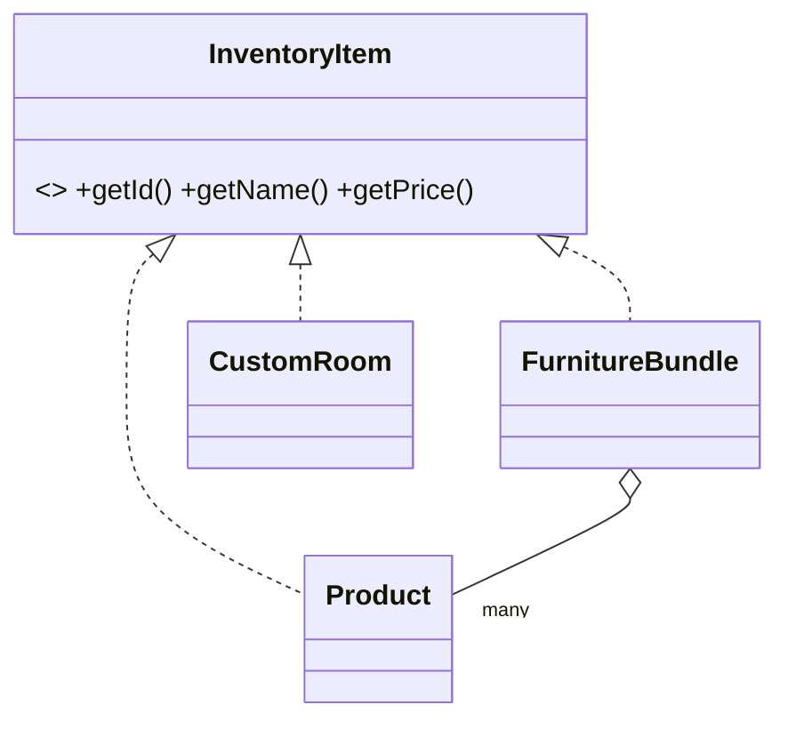
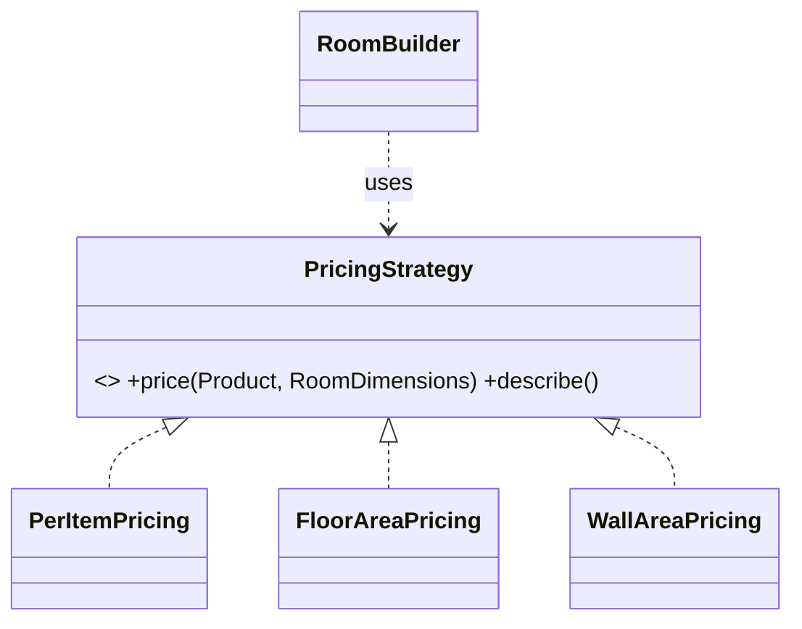
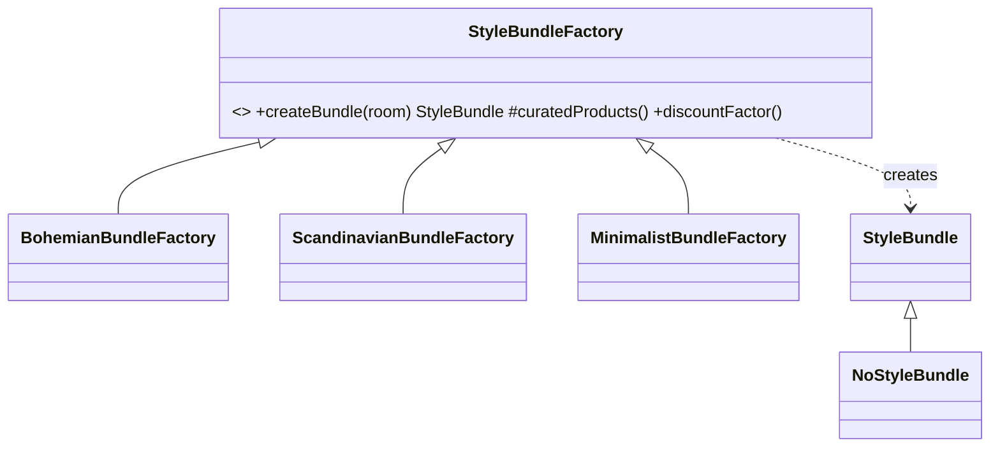
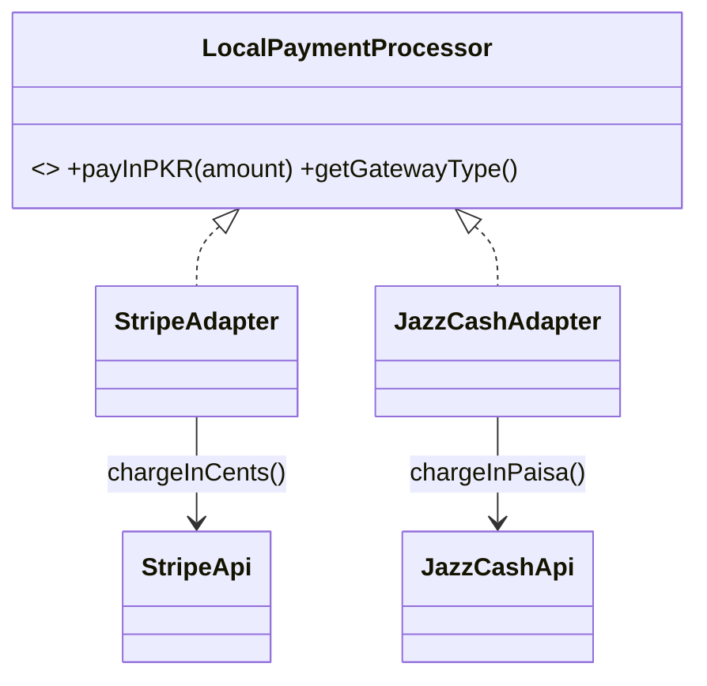

# Design patterns in Palette

Palette uses seven Gang-of-Four patterns. Each lives in its own package under
`backend/src/main/java/com/palette/palette/patterns/` and has its own tests
under `backend/src/test/java/com/palette/palette/patterns/`.

| # | Pattern | Type | Where | What it does in Palette |
|---|---|---|---|---|
| 1 | Composite | Structural | `patterns/composite` | Products, bundles and custom rooms are all priced the same way in the cart |
| 2 | Builder | Creational | `patterns/builder` | Builds a custom room step by step and prices it |
| 3 | Strategy | Behavioural | `patterns/strategy` | Chooses how a product is priced in a room: per item, per floor area or per wall area |
| 4 | Factory Method | Creational | `patterns/factory` | Each style creates its own curated furniture bundle for the style quiz |
| 5 | Null Object | Behavioural | `patterns/nullobject` | A safe "no recommendation" bundle instead of `null` or an error |
| 6 | Adapter | Structural | `patterns/adapter` | Pays in rupees through gateways that expect US cents or paisa |
| 7 | Singleton | Creational | `patterns/singleton` | One `PaymentManager` handles every charge |

The patterns work together in two flows:

- **Room Builder:** Builder → Strategy → Composite
- **Checkout:** Composite → Singleton → Adapter

```
Room Builder:  RoomBuilder ──uses──▶ PricingStrategy ──▶ CustomRoom (an InventoryItem)
Style quiz:    AestheticBundleFactory ──▶ StyleBundleFactory.createBundle() ──▶ StyleBundle | NoStyleBundle
Checkout:      Cart lines (InventoryItem.getPrice()) ──▶ Order ──▶ PaymentManager ──▶ StripeAdapter | JazzCashAdapter
```

---

## 1. Composite: one way to price anything in the cart

**Problem.** The cart holds three kinds of things: a single product, a bundle
of products, and a custom room. Without a shared interface, the cart and
checkout would need a separate price calculation for each kind.

**Solution.** All three implement `InventoryItem` (`getId`, `getName`,
`getPrice`). A bundle's price is built from its products; a room's price is
built from its flooring, wallpaper and furniture.

| Role | Class |
|---|---|
| Component | `patterns/composite/InventoryItem` |
| Leaf | `entities/Product`: its own price |
| Composite | `entities/FurnitureBundle`: sum of its products × bundle discount |
| Composite | `entities/CustomRoom`: flooring + wallpaper + furniture |
| Client | `services/CartManager.priceLines()`, also used by checkout in `OrderService` |



**Why it matters.** `CartManager.priceLines()` is the only place cart prices
are calculated, and checkout calls the same method. That is why the cart total
and the order total always match. Before Phase 2 they could differ.

**Tests:** `CompositeInventoryTest`, `CheckoutFlowTest`.

---

## 2. Builder: assembling a custom room

**Problem.** A room has two required parts (type and size), two optional parts
(flooring, wallpaper) and one or more furniture pieces. A constructor with all
of these would be hard to read, and a half-finished room should never exist.

**Solution.** `RoomBuilder` collects the parts one call at a time.
`build()` checks the room is complete and works out its price.

```java
CustomRoom room = new RoomBuilder("LIVING_ROOM", 12, 15) // required: type + size
        .withFlooring(hardwood)                          // optional
        .withWallpaper(botanical)                        // optional
        .addFurniture(sofa)                              // at least one
        .addFurniture(rug)
        .build();                                        // validates + prices
```

| Role | Class |
|---|---|
| Builder | `patterns/builder/RoomBuilder` |
| Product | `entities/CustomRoom` |
| Director | `services/RoomBuilderService.assemble()`: loads the chosen products and drives the builder |

**Rules `build()` enforces.** At least one furniture item. Flooring must be a
`FLOORING` product and wallpaper a `WALLPAPER` product. Width and length must
be greater than 0. The price is always calculated from the parts, so it can't
be set to a wrong value from outside.

**Tests:** `RoomBuilderTest`, `RoomAndQuizTest`.

---

## 3. Strategy: how a product is priced in a room *(7th pattern)*

**Problem.** The same catalogue price means different things for different
products. A sofa is priced per item; flooring is priced per square foot of
floor; wallpaper is priced per square foot of wall. An `if/else` chain on the
category would grow with every new rule.

**Solution.** Each rule is a separate class behind one interface. The builder
asks `PricingStrategies.forProduct(product)` which rule applies, then uses it.

| Role | Class | Rule |
|---|---|---|
| Strategy | `patterns/strategy/PricingStrategy` | `price(product, room)` |
| Concrete strategy | `PerItemPricing` | price |
| Concrete strategy | `FloorAreaPricing` | price × width × length |
| Concrete strategy | `WallAreaPricing` | price × 2 × (width + length) × 10 ft |
| Selector | `PricingStrategies.forProduct()` | FLOORING → floor, WALLPAPER → wall, anything else → per item |
| Context | `patterns/builder/RoomBuilder` | adds up the strategy prices |



**Example.** A 10 × 12 ft room has 120 sq ft of floor and 440 sq ft of wall.
Flooring at 100 PKR/sq ft costs 12,000. Wallpaper at 55 PKR/sq ft costs 24,200.

**Adding a rule** (for example "per running foot of skirting board") means one
new class and one line in `PricingStrategies`. The builder doesn't change.

**Tests:** `PricingStrategyTest`, `RoomBuilderTest`.

---

## 4. Factory Method: one bundle creator per style

**Problem.** The style quiz gives a style (Bohemian, Scandinavian, Minimalist)
and a room. Each style has its own products, description and discount. The
steps for making a bundle are the same for every style; only those details
differ.

**Solution.** The abstract creator `StyleBundleFactory` owns the factory
method `createBundle(room)`. It always does the same steps: look up the room's
products and package them with the style's name and discount. Each subclass
supplies the details that differ.

| Role | Class |
|---|---|
| Creator (abstract) | `patterns/factory/StyleBundleFactory`: `createBundle(room)` is the factory method |
| Concrete creators | `BohemianBundleFactory` (5% off), `ScandinavianBundleFactory` (8% off), `MinimalistBundleFactory` (no discount) |
| Product | `patterns/factory/StyleBundle` |
| Entry point | `AestheticBundleFactory.createBundle(style, room)`: finds the right creator |
| Client | `services/DesignQuizService` |



**Adding a style** means one new subclass registered in `AestheticBundleFactory`.
No other code changes.

**Safety net.** `SeedDataTest` checks that every product ID a factory
recommends exists in the database with the right style and room. This test
caught products 16–18 being filed under the wrong room.

**Tests:** `AestheticBundleFactoryTest`, `SeedDataTest`, `RoomAndQuizTest`.

---

## 5. Null Object: "no recommendation" without `null`

**Problem.** Some quiz answers have no curated set (for example an unknown room
or style). Returning `null` would force every caller to check for it, and
throwing an error would show the user an error page.

**Solution.** The factories return a `NoStyleBundle`. It looks and acts like a
real bundle: no products, no discount, the name "NONE", and it can't be filled.
Callers use it like any other bundle; the only question they may ask is
`isAvailable()`.

| Role | Class |
|---|---|
| Abstract object | `patterns/factory/StyleBundle` |
| Real object | `StyleBundle` (from the concrete factories) |
| Null object | `patterns/nullobject/NoStyleBundle` |

**In the app.** `DesignQuizService` answers with "We don't have a curated set
for that combination yet", and doesn't save that answer to the user's quiz
history. Before Phase 2, an unknown room crashed the request before the null
object could be used.

**Frontend version.** `PaymentPage.jsx` uses the same idea with
`NullPaymentResult`: a failed payment still produces a result object, so the
result screen never has to handle `null`.

**Tests:** `AestheticBundleFactoryTest`, `RoomAndQuizTest`.

---

## 6. Adapter: paying in rupees through foreign gateways

**Problem.** Palette works in Pakistani rupees, but each gateway has its own
API: Stripe charges whole US cents and JazzCash charges paisa.

**Solution.** One Target interface, `LocalPaymentProcessor.payInPKR(amount)`,
with an adapter per gateway that converts the amount and calls the gateway's
own API.

| Role | Class | Conversion |
|---|---|---|
| Target | `patterns/adapter/LocalPaymentProcessor` | `payInPKR(double)` |
| Adapter | `StripeAdapter` | PKR ÷ 280 = USD, × 100 = cents |
| Adaptee | `StripeApi` | `chargeInCents(int)` |
| Adapter | `JazzCashAdapter` | PKR × 100 = paisa |
| Adaptee | `JazzCashApi` | `chargeInPaisa(long)` |
| Client | `patterns/singleton/PaymentManager` | |



`StripeApi` and `JazzCashApi` are simulated: no real money moves. Connecting a
real gateway would mean replacing the adaptee; nothing else in the app changes.

**Tests:** `PaymentAdapterTest`, `CheckoutFlowTest`.

---

## 7. Singleton: one payment manager

**Problem.** Every charge should go through one place that chooses the gateway
and checks the amount.

**Solution.** `PaymentManager` has a private constructor and a thread-safe,
lazily created `getInstance()` (double-checked locking on a `volatile` field).

**How it fits with Spring.** Spring normally creates its own objects, which
would mean a second `PaymentManager`. Before Phase 2 that is what happened.
Now `config/PaymentConfig` registers `PaymentManager.getInstance()` as the
Spring bean, so the app and any plain Java code share exactly one instance.

| Role | Class |
|---|---|
| Singleton | `patterns/singleton/PaymentManager` |
| Spring wiring | `config/PaymentConfig` |
| Client | `services/PaymentService` |

**Tests:** `PaymentAdapterTest` (`getInstance()` always returns the same object),
`ApiSecurityTest.springUsesTheRealPaymentManagerSingleton`.

---

## Where each pattern shows up when using the app

| You do this in the app | Patterns involved |
|---|---|
| Take the style quiz | Factory Method → Null Object (if there's no match) |
| Build a custom room | Builder → Strategy |
| Look at your cart | Composite |
| Pay for an order | Singleton → Adapter |
